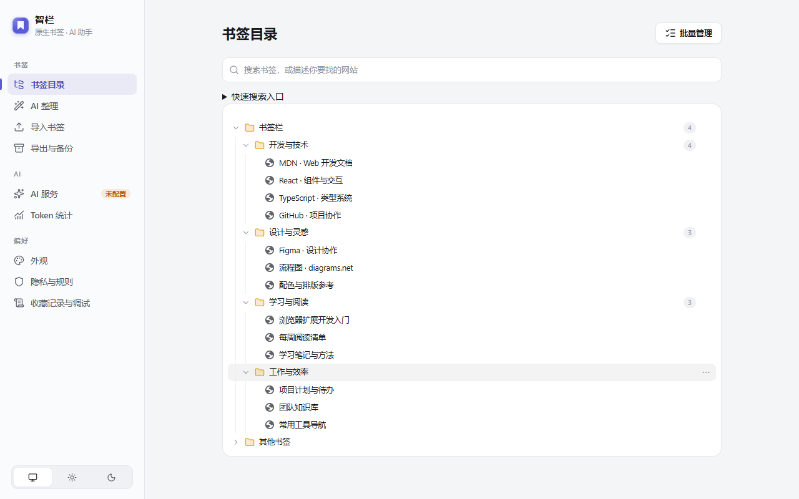
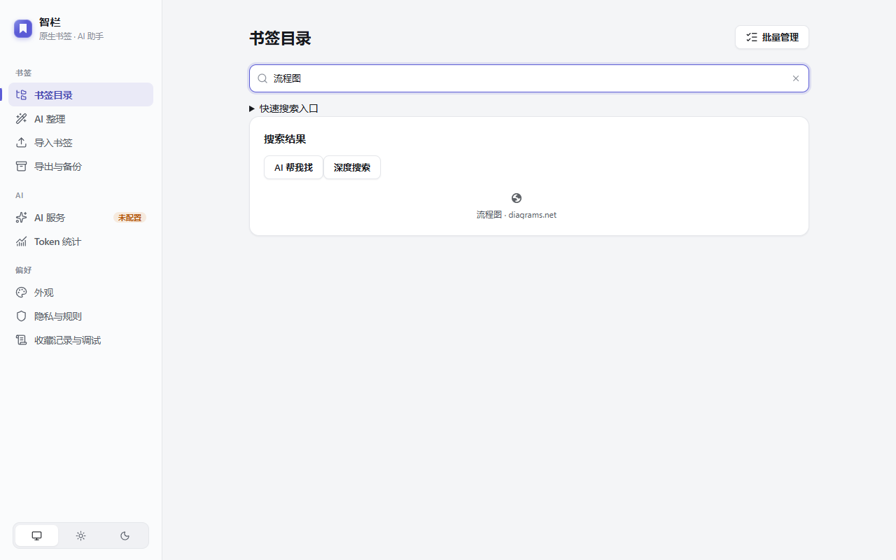
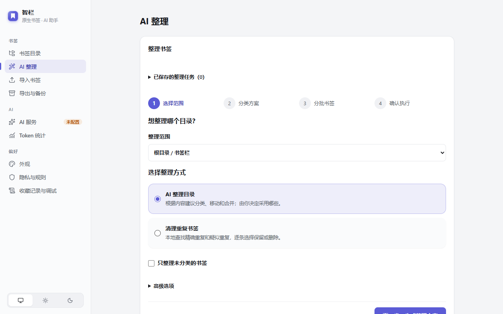

  
  <h1>智栏 · Zhilan</h1>
  
<strong>帮你把书签收好，也帮你把它们找回来。</strong>

  
Chrome / Edge 书签助手 · 自动归类 · AI 搜索 · 批量整理

  简体中文 · <a href="README.en.md">English</a> 
  <a href="#快速开始">快速开始</a> ·
  <a href="docs/guides/user-guide.md">使用手册</a> ·
  <a href="docs/media/zhilan-quick-tour.mp4">演示视频</a> ·
  <a href="https://github.com/AiYeyeye/smartSave/issues">反馈问题</a>

## 可以帮你做什么

书签越存越多，想用的时候却找不到。智栏把收藏、搜索和整理放在一起，让你少翻几层文件夹。

| 功能 | 用法 |
| --- | --- |
| 收藏自动归类 | 点星标收藏网页，智栏按网站规则或你配置的 AI 帮你归类；放错了可以纠正或撤销。 |
| 描述一下就能找 | 记不清标题时，试着用自己的话描述。也支持普通关键词、网址、拼音和首字母搜索。 |
| 找回浏览过的网页 | 按需启用历史查询，按时间、标题或网址查找；也可主动使用 AI 理解描述，找到后直接收藏。 |
| 一次整理一批 | 选择要整理的文件夹，先看 AI 建议，再决定是否应用。生成过程中可以关掉页面，稍后回来查看。 |
| 书签检查 | 侧栏内检查失效链接和重复收藏，支持每周检查、一键预览并确认清理。 |
| 导入、导出与恢复 | 支持多种常见书签文件格式，也能查看操作记录、预览撤销和恢复。 |

你收藏的网页仍保存在浏览器书签里，智栏直接帮你管理，不需要再注册一个账号或搬到别的平台。

看看搜索和整理界面

### 搜索书签

### 批量整理

截图中的书签为演示数据。

## 快速开始

需要 **Chrome / Edge 127+**。

1. 从 [下载页面](https://github.com/AiYeyeye/smartSave/releases/tag/v0.1.0-preview.20261025.1) 下载 **zhilan-0.1.0-candidate.zip**，解压到固定文件夹。
2. 打开 `chrome://extensions` 或 `edge://extensions`，开启**开发者模式**。
3. 点击**加载已解压的扩展程序**，选择解压后包含 `manifest.json` 的文件夹。
4. 把智栏固定到工具栏，点击图标打开书签侧栏。

这是供试用的候选版，安装无需 Node 或 pnpm。更新方式见 [安装指南](docs/guides/install.md)；从源码构建见 [开发文档](extension/README.md)。

不连接 AI 也能浏览、搜索和管理书签。想使用自动归类和 AI 搜索，在**设置 → AI 服务**中添加已有的模型服务，再给相应功能选择模型。首次安装后，侧栏会显示配置 AI、收藏、搜索和整理的操作步骤。关闭后不再自动显示，可从侧栏设置中的“新手操作步骤”重新打开。

支持 OpenAI 兼容服务、OpenAI Responses、Anthropic、Gemini，以及 Ollama、LM Studio 等本地服务。具体配置见 [模型设置](docs/guides/model-setup.md)。

## 用起来更顺手

| 操作 | 方式 |
| --- | --- |
| 打开搜索 | `Alt+Shift+K` |
| 从地址栏找书签 | 输入 `zl`，按 Tab 或空格，再输入关键词 |
| 在智栏里聚焦搜索 | `Ctrl+K`，Mac 使用 `⌘K` |
| 切换侧栏样式 | 在外观设置中选择网页侧栏或浏览器侧边栏 |
| 切换语言与主题 | 快速设置和外观设置支持中英文、浅色/深色及主题色 |

快捷键冲突时，可在浏览器的扩展快捷键设置中修改。

## 书签和隐私

普通搜索在本机完成。启用 AI 后，相关书签信息会直接发送到你选择的模型服务；你可以设置不参与 AI 处理的文件夹。语言和外观偏好可以跟随浏览器同步，服务密钥和规则保存在本机。

更多说明见 [隐私政策](docs/privacy.md)。

## 文档与参与

- [使用手册](docs/guides/user-guide.md) · [安装说明](docs/guides/install.md) · [恢复操作](docs/guides/recovery.md)
- [文档导航](docs/README.md) · [开发说明](extension/README.md) · [更新日志](CHANGELOG.md)
- [参与贡献](CONTRIBUTING.md) · [问题反馈](SUPPORT.md) · [安全报告](SECURITY.md)

欢迎提交问题、改进建议和 Pull Request。

## 许可

本项目采用 [PolyForm Noncommercial 1.0.0](LICENSE) 许可证。

维护者：Astraxine · [联系邮箱](mailto:mmgnosit@gmail.com)
