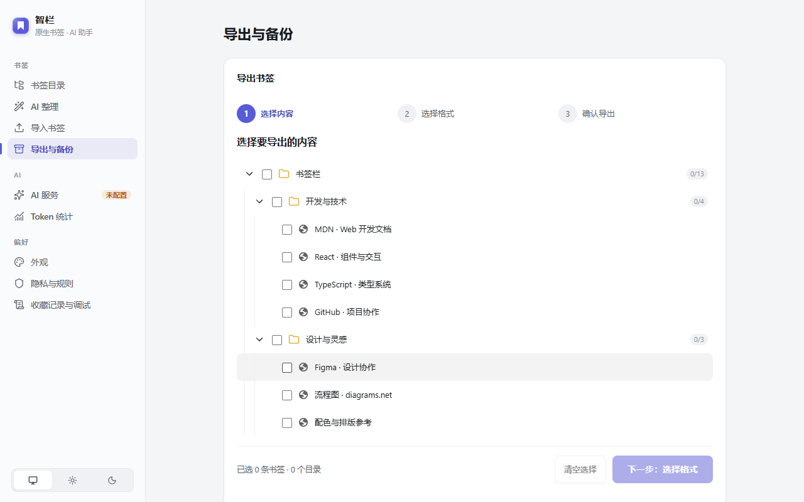
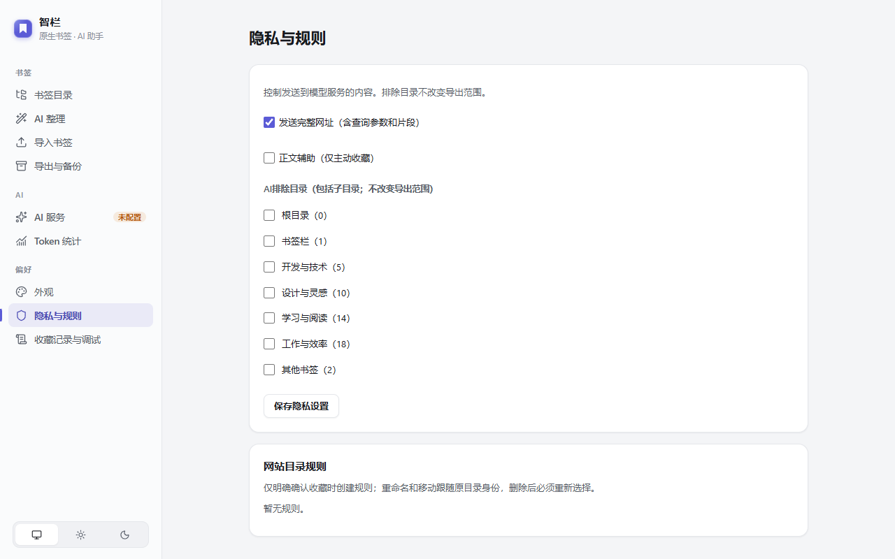

# 智栏使用手册

把智栏当作浏览器书签的一个更方便的入口：**先用本地搜索，需要时再连接 AI。** 书签仍保存在 Chrome / Edge 中，不需要注册智栏账号。

## 1. 安装与打开

目前提供源码安装，商店链接将在正式上架后补充。按 [安装说明](install.md) 构建并加载 `extension/dist`，然后把智栏固定到工具栏。

点击智栏图标打开侧栏。默认从网页左侧浮出，按 Esc 或点空白处收起；在“外观”里可改为浏览器侧边栏。浏览器内部页面会使用浏览器侧边栏。点“设置”进入完整工作台。

## 2. 查找与管理书签

- 在搜索框输入标题、网址或目录名，也支持中文拼音和首字母；普通搜索在本机完成。
- 点击结果打开书签；右键或点击书签操作按钮，可编辑、移动、复制链接或删除。删除前检查确认框。
- 快捷键：`Alt+Shift+K` 打开搜索；智栏界面内 `Ctrl+K`（Mac 为 `⌘K`）聚焦搜索。冲突时到扩展快捷键设置修改。
- 地址栏输入 `zl`，按 Tab 或空格，再输入关键词。选择候选打开书签，直接回车进入完整搜索页。

## 3. 连接 AI（可选）

1. 打开 **设置 → AI 服务 → 添加连接**，选择已有的服务，填写地址和 API Key。
2. 获取模型列表，明确选择一个模型并保存；列表不支持时可手动填写模型 ID。
3. 为智能收藏、导入、搜索和整理分别指定模型，检查 **隐私与规则** 中的发送范围。
4. 用“试分类当前网页”看推荐结果；试用不会创建或移动书签，但会把当前页的允许信息发送给所选服务。

AI 费用由你的服务商收取。记住密钥会把密钥明文保存在浏览器扩展本地存储；添加连接当前默认勾选记住，请按需取消。临时密钥在原页面关闭或刷新后会丢失，原生收藏后台自动归类通常需要已保存的凭据。详细步骤见 [模型设置](model-setup.md)。

## 4. 收藏、AI 搜索与整理

**收藏：** 配置好智能收藏后，像平常一样点浏览器星标或按 `Ctrl+D`。智栏先尝试本地规则，再按配置调用 AI 归类新书签。未配置或失败时书签留在浏览器中，可在“收藏记录与调试”查看处理结果、纠正目录或撤销。网站规则需要另行确认保存。

**AI 搜索：** 不记得名字时，输入“之前收藏的那个画流程图的网站”，点击“AI 帮我找”。“深度搜索”会分批检查允许发送的整个书签范围，通常更慢、消耗更多 Token；不会自动在普通搜索时运行。

**整理：** 进入“AI 整理”，选择目录，检查规则与模型，生成并审核目录方案，再分析书签。可以查看目标目录和变化，关闭工作台后重新打开查看后台进度。发生中断时按提示手动继续。**最后点击确认执行前，生成方案不会修改书签。**

**重复清理：** 在整理页进入重复检查，区分精确重复和疑似链接变体，检查原始链接，选择保留项后确认删除。疑似重复不代表内容一定相同。

## 5. 导入、导出与恢复

**导入：** 支持 HTML、JSON、CSV、TXT、Markdown。选择文件和目标目录，检查解析与分类结果，再确认导入。浏览器导出的书签 HTML 通常最方便。

**导出：** 在“导出与备份”选择范围，再选 HTML（迁移到浏览器）、JSON（程序使用）或 Markdown（阅读）。导出保留原始网址，**不含 API Key、模型配置、网站规则和恢复日志，也不是完整恢复备份**。

**恢复：** 展开“备份与恢复记录”，先预览撤销，再确认应用。若显示“结果未知”，先“核对当前状态（不重放）”，不要重复整理、清空存储或卸载。详见 [恢复说明](recovery.md)。

自动更新本地 JSON 文件是可选高级功能，只授权专用文件；后续更新会覆盖它，浏览器关闭期间不会更新。

## 6. 隐私与常见问题

在“隐私与规则”排除不想发给 AI 的目录，按需关闭“发送完整网址”和正文辅助；排除 AI 不等于排除手动导出。网址查询参数可能包含私人信息。正文辅助默认关闭。完整说明见 [隐私政策](privacy.md)。

| 遇到的情况 | 怎么处理 |
| --- | --- |
| 不想用 AI | 直接使用目录、本地搜索、手动管理和导出 |
| AI 提示未配置或无模型 | 在 AI 服务里检查连接和该功能的模型分配 |
| 401 / 403 | 检查 Key、服务地址及授权；不要把 Key 发给他人 |
| 超时或中断 | 保留已完成结果，检查服务，再使用界面提供的重试/继续 |
| 快捷键无效 | 在 `chrome://extensions/shortcuts` 或 `edge://extensions/shortcuts` 检查冲突 |
| 操作结果未知 | 先核对恢复记录，不重复执行 |

演示视频：[约半分钟的界面操作](media/zhilan-quick-tour.mp4)（无声，虚构书签，未调用真实 AI）。问题反馈见 [SUPPORT](../SUPPORT.md)。
